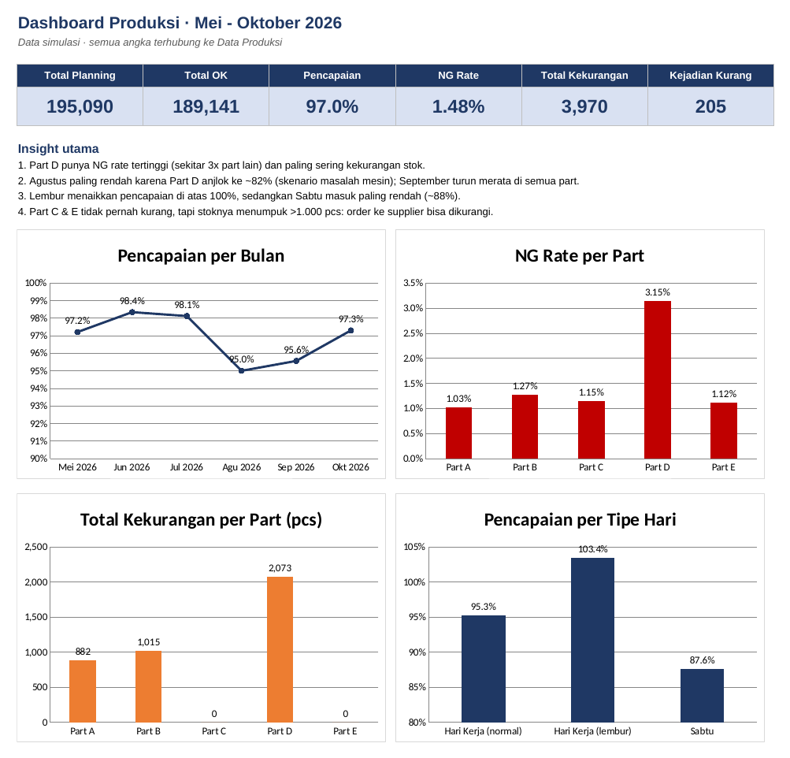
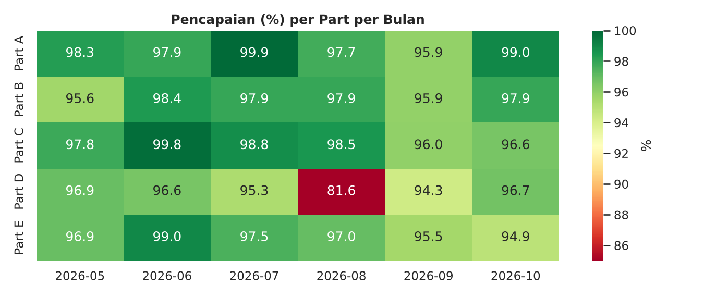
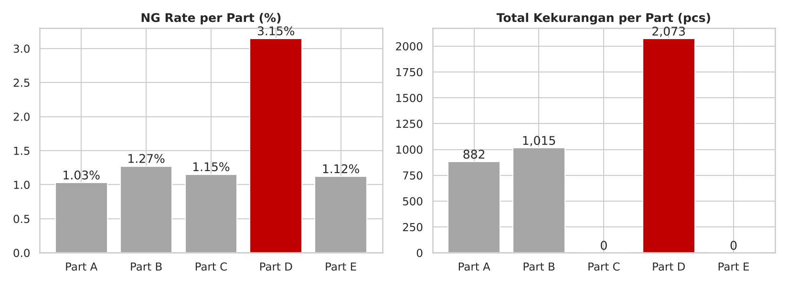

# Production Monitoring Dashboard: Excel + Python + SQL


Sistem monitoring produksi harian untuk lini perakitan. Isinya template input harian, rekap otomatis, dan dashboard di Excel, ditambah analisis lanjutan dengan Python dan SQL.

Project ini dikembangkan dari template rekap produksi yang saya buat dan pakai sendiri waktu bekerja sebagai **Production Operator** di perusahaan manufaktur elektronik.

> ⚠️ **Data di repository ini simulasi** (dibuat dengan `scripts/generate_data.py`). Nama perusahaan, model, line, dan part sudah dianonimkan. Struktur kolom dan logika perhitungannya mengikuti template asli.



---

## 📌 Latar Belakang

Di lini produksi, setiap hari operator harus mencatat **planning, stok sendiri, stok dari supplier, dan hasil produksi** untuk beberapa part yang dikirim ke line berikutnya. Masalah yang sering terjadi:

- Rekap dikerjakan manual per hari, jadi rawan salah hitung
- Kekurangan stok baru ketahuan mendadak, saat part sudah harus dikirim
- Tidak ada ringkasan bulanan untuk melihat part mana yang paling sering bermasalah

## 💡 Solusi

**1. Template Excel (versi awal, dipakai di tempat kerja)**
- Lembar harian dengan sel input (biru) dan sel otomatis (kuning)
- Rumus otomatis untuk total stok, sisa, dan kekurangan
- Rekap bulanan yang menarik angka dari setiap lembar harian
- Macro VBA untuk membuat sheet bulan baru beserta stok awal otomatis

**2. Versi portofolio (repository ini)**
- Data disusun ulang jadi **1 tabel rapi** (1 baris = 1 part per 1 hari), bukan 1 sheet per hari, supaya bisa dianalisis
- **Laporan Harian** dinamis: cukup ganti tanggal, semua angka per part terisi otomatis
- **Rekap Bulanan** dan **Rekap Part** + heatmap pencapaian
- **Dashboard** KPI dan 4 grafik
- **Notebook Python + SQL** untuk analisis lanjutan dan rekomendasi

---

## 📊 Hasil Analisis

Periode: **Mei – Oktober 2026** · 141 hari kerja · 5 part · 705 baris data

| KPI | Nilai |
|---|---|
| Total Planning | 195.090 pcs |
| Total OK | 189.141 pcs |
| Pencapaian | 97,0% |
| NG Rate | 1,48% |
| Total Kekurangan | 3.970 pcs |



### Insight & Rekomendasi

| # | Temuan | Rekomendasi |
|---|---|---|
| 1 | **Part D** punya NG rate 3,15%, sekitar 3x part lain, dan kekurangan di 68% hari kerja. | Prioritaskan perbaikan kualitas di proses Part D. |
| 2 | **Agustus** jadi bulan terendah (95,0%) karena Part D anjlok ke 81,6%. | Pasang alert otomatis kalau pencapaian part < 90%. |
| 3 | **Lembur** menaikkan pencapaian ke 103,4%, sedangkan **Sabtu masuk** paling rendah (87,6%). | Arahkan lembur ke part yang sedang kurang, evaluasi efektivitas Sabtu masuk. |
| 4 | **Part C & E** tidak pernah kurang, tapi stoknya menumpuk sampai >1.000 pcs. | Kurangi atau jadwalkan ulang order supplier. |



---

## 📁 Struktur Repository

```
├── Production_Monitoring_Dashboard.xlsx   # workbook utama (6 sheet)
├── data/
│   └── produksi_harian.csv                # data simulasi
├── notebooks/
│   └── analisis_produksi.ipynb            # analisis Python + SQL
├── scripts/
│   ├── generate_data.py                   # pembuat data simulasi
│   ├── build_excel.py                     # pembuat workbook Excel
│   └── build_notebook.py                  # penyusun notebook
├── images/                                # grafik untuk README
├── requirements.txt
└── README.md
```

### Isi Workbook Excel

| Sheet | Fungsi |
|---|---|
| Tentang | Penjelasan project, keterangan warna, dan rumus |
| Dashboard | 6 KPI + 4 grafik + insight utama |
| Laporan Harian | Pilih tanggal, laporan per part terisi otomatis (`INDEX/MATCH`, `SUMIFS`) |
| Rekap Bulanan | Ringkasan per bulan + heatmap pencapaian part × bulan |
| Rekap Part | Ringkasan per part + perbandingan hari normal / lembur / Sabtu |
| Data Produksi | Tabel data dengan validasi input (dropdown) dan conditional formatting |

### Rumus Utama

| Kolom | Rumus |
|---|---|
| OK | Produksi − NG |
| Total Tersedia | Stok Awal + Stok Supplier + OK |
| Kekurangan | MAX(0, Planning − Total Tersedia) |
| Stok Akhir | MAX(0, Total Tersedia − Planning) |
| Pencapaian | OK / Planning |
| NG Rate | NG / Produksi |

---

## 🚀 Cara Menjalankan

```bash
git clone https://github.com/[username]/production-monitoring.git
cd production-monitoring
pip install -r requirements.txt

# (opsional) buat ulang data & workbook
python scripts/generate_data.py
python scripts/build_excel.py
```

Buka `notebooks/analisis_produksi.ipynb` untuk analisisnya, atau langsung buka file Excel-nya.

---

## 🛠️ Tech Stack

- **Excel:** SUMIFS, COUNTIFS, INDEX/MATCH, IFERROR, data validation, conditional formatting, chart, VBA (versi asli)
- **Python:** Pandas, Matplotlib, Seaborn, openpyxl
- **SQL:** SQLite (agregasi, CASE WHEN, subquery)

---

## 👤 Author

**Muhammad Dikaisa Ibnu Amin**
Fresh graduate Teknik Informatika, tertarik di bidang Data Analyst & Data Science

- LinkedIn: `[link LinkedIn]`
- Email: muhammaddikaisa1@gmail.com
